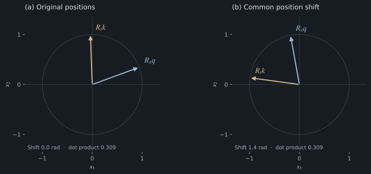

# 2. Rotary transformations and relative position

## Two-dimensional orthogonal rotations

Take a vector $x=(x_1,x_2)^\top$. A counterclockwise rotation by $\phi$ is

$$
R(\phi)=
\begin{pmatrix}
\cos\phi&-\sin\phi\\
\sin\phi&\cos\phi
\end{pmatrix}.
$$

Multiplication produces

$$
R(\phi)x=
\begin{pmatrix}
x_1\cos\phi-x_2\sin\phi\\
x_1\sin\phi+x_2\cos\phi
\end{pmatrix}.
$$

The coordinates change, but the distance from the origin does not:

$$
R(\phi)^\top R(\phi)=I,\qquad \|R(\phi)x\|_2=\|x\|_2.
$$

This is why a rotation changes alignment without artificially making a query or key larger. Since $q^\top k=\|q\|\|k\|\cos\alpha$, the dot product responds to the angle between vectors.

*Figure 1. Common-shift invariance in two dimensions. Both panels apply different absolute rotations to fixed query and key vectors while preserving their relative angle and dot product. The unit-circle reference and coordinate axes are identical.*

## Position-indexed query and key transformations

Choose a frequency $\theta$, measured in radians per token. Rotate the query at $s$ by $s\theta$, and the key at $t$ by $t\theta$:

$$
q'_s=R(s\theta)q_s,\qquad k'_t=R(t\theta)k_t.
$$

Their interaction is

$$
\begin{aligned}
(q'_s)^\top k'_t
&=q_s^\top R(s\theta)^\top R(t\theta)k_t\\
&=q_s^\top R(-s\theta)R(t\theta)k_t\\
&=q_s^\top R((t-s)\theta)k_t.
\end{aligned}
$$

The positional factor depends only on the displacement between the query and key.

Throughout this book,

$$
\Delta=t-s=\text{key position}-\text{query position}.
$$

For causal attention, $t\le s$, so $\Delta\le0$. Plots often use nonnegative lag $r=s-t=-\Delta$. The positional kernel introduced later is even, but a general content-dependent score is not. Changing the sign convention without adjusting sine terms changes the computation.

## Numerical evaluation of relative rotations

Let $q=k=(1,0)^\top$ and $\theta=\pi/4$.

| $t-s$ | Relative angle | Dot product |
|---:|---:|---:|
| 0 | 0 | 1 |
| 1 | $\pi/4$ | $1/\sqrt2$ |
| 2 | $\pi/2$ | 0 |
| 8 | $2\pi$ | 1 |

The periodic dot product is not a monotonic function of displacement.

Shift both positions by 100. The relative angle remains the same:

$$
R((s+100)\theta)^\top R((t+100)\theta)=R((t-s)\theta).
$$

The tests check this common-shift identity with random content vectors and high precision.

## Translation invariance conditional on fixed content

RoPE uses absolute indices to tell each vector how far to rotate. The resulting positional interaction depends on relative displacement. Both descriptions refer to different stages of the computation.

This identity holds **conditional on fixed content vectors**. In a multi-layer language model, changing or prepending text can change $q_s$ and $k_t$ themselves. It does not promise that a model's answer is invariant when its prompt changes.

## Block-diagonal rotations within an attention head

For even head dimension $d_h=2M$, choose $M$ frequencies:

$$
R_s=\operatorname{diag}\big(R(s\theta_0),\ldots,R(s\theta_{M-1})\big).
$$

Then

$$
(R_s q_s)^\top(R_t k_t)=q_s^\top R_{t-s}k_t.
$$

Each pair rotates independently. No full dense matrix is needed: elementwise sine/cosine products and a pairing operation suffice.

Standard RoPE rotates **projected queries and keys**, after their learned linear maps. Values are usually left unrotated by this operation. Earlier layers can already make values sensitive to context and order.

[Section 3: Frequency spectra and positional representations →](03-frequencies.md)
