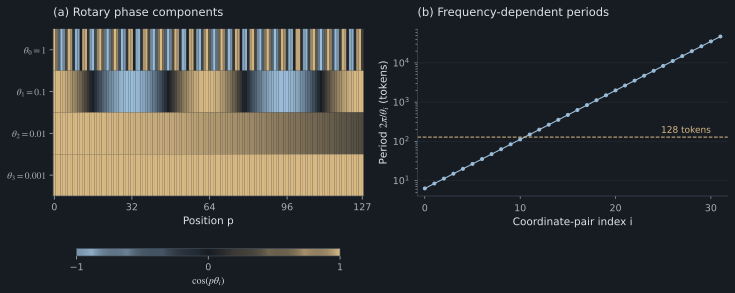

# 3. Frequency spectra and positional representations

## Periodicity of a single rotary component

A rotary pair at frequency $\theta$ satisfies

$$
R((\Delta+T)\theta)=R(\Delta\theta),\qquad T=\frac{2\pi}{\theta}.
$$

This period is defined on a continuous position axis. Token indices are integers; when $T$ is not an integer, an exact recurrence at an integer offset does not follow.

Repeating the same frequency across coordinate pairs adds content dimensions without adding positional timescales. The experimental **single_rope** variant isolates this restriction.

## Geometric frequency schedule

For head dimension $d_h=2M$, a conventional schedule is

$$
\theta_i=B^{-2i/d_h},\qquad i=0,\ldots,M-1.
$$

With $B=10000$ and $d_h=8$:

| Pair | Frequency, radians per token | Continuous period, tokens |
|---|---:|---:|
| 0 | 1 | 6.28 |
| 1 | 0.1 | 62.83 |
| 2 | 0.01 | 628.32 |
| 3 | 0.001 | 6283.19 |

High-frequency components change substantially between nearby positions. Low-frequency components vary across longer intervals. Their joint representation is

$$
\Phi(\Delta)=\big(e^{i\Delta\theta_0},\ldots,e^{i\Delta\theta_{M-1}}\big).
$$

*Figure 2. Frequency spectrum of RoPE. Left: $\cos(p\theta_i)$ for four frequencies and integer positions $p=0,\ldots,127$; color represents the signed cosine value. Right: periods $2\pi/\theta_i$ for a 64-dimensional head. The 128-token reference line specifies a comparison scale rather than a measured model limit.*

## Content-dependent sinusoidal score expansion

For a pair $q_i=(a,b)$ and $k_i=(c,d)$,

$$
q_i^\top R(\Delta\theta_i)k_i
=(ac+bd)\cos(\Delta\theta_i)+(bc-ad)\sin(\Delta\theta_i).
$$

The content vectors determine the coefficients. The positional spectrum determines the trigonometric basis. The complete score sums these contributions and divides by $\sqrt{d_h}$.

With $z_q=a+ib$ and $z_k=c+id$,

$$
q_i^\top R(\Delta\theta_i)k_i
=\operatorname{Re}\left[\overline{z_q}z_k e^{i\Delta\theta_i}\right].
$$

RoPE therefore supplies content-dependent relative-phase features rather than a single fixed distance penalty. Individual head functions require empirical or mechanistic analysis; they cannot be inferred from the frequency schedule alone.

## Coordinate pairing and checkpoint compatibility

The derivation pairs adjacent coordinates $(0,1),(2,3),\ldots$. Some implementations pair the first and second halves of the head. These conventions are equivalent under a fixed coordinate permutation when the query/key projections and frequency assignment use the corresponding basis.

Changing the pairing function in a loaded checkpoint without transforming the associated projections generally changes the model. Frequency order, sign convention, rotary dimension, and projection basis must agree.

## Euclidean distance between normalized phase codes

Define

$$
\psi(\Delta)=\frac1{\sqrt M}
(\cos(\Delta\theta_0),\sin(\Delta\theta_0),\ldots).
$$

Then

$$
\|\psi(a)-\psi(b)\|_2^2=2-2C(a-b),\qquad
C(r)=\frac1M\sum_i\cos(r\theta_i).
$$

Large $C(a-b)$ indicates proximity of the normalized positional codes. It does not by itself establish confusion in a trained model, which also depends on learned content representations.

[Section 4: Phase cancellation and distance-dependent similarity →](04-decay.md)
