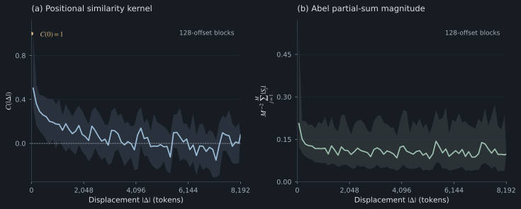
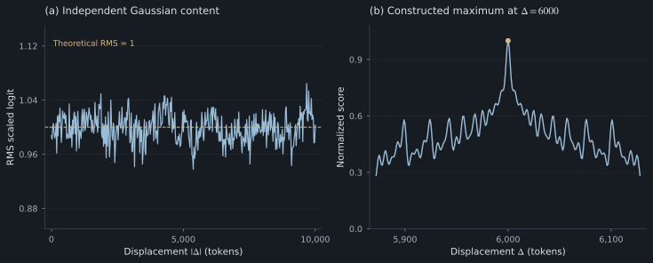

# 4. Phase cancellation and distance-dependent similarity

Pure RoPE preserves vector norms. Distance dependence arises through phase alignment and content-dependent coefficients.

## Norms, similarity, logits, and attention probabilities

| Quantity | Definition or mechanism | Interpretation |
|---|---|---|
| Vector norm | $\|R_s q\|=\|q\|$ | Pure RoPE has no amplitude decay |
| Positional similarity | $C(\Delta)=M^{-1}\sum_i\cos(\Delta\theta_i)$ | Broad cancellation can coexist with oscillations |
| Content-dependent score | $q^\top R_\Delta k/\sqrt{d_h}$ | Learned content changes the phase mixture |
| Attention probability | Softmax over all allowed scores | Distractors and masks matter too |

The [RoFormer analysis](https://arxiv.org/html/2104.09864v5#S3.SS4.SSS3) uses Abel summation to study rotating phase sums. Its decay discussion motivates aggregate cancellation. It is not a universal monotonic decrease of every learned score or probability.

## Normalized positional similarity kernel

The notes define

$$
C(\Delta)=\frac1M\sum_{i=0}^{M-1}\cos(\Delta\theta_i).
$$

This is an inner product between normalized phase codes, not a Pearson correlation, probability density, or attention distribution.

Set every pair of both unrotated vectors to $(1,0)$. Their relatively rotated dot product, divided by $M$, equals $C(\Delta)$. At zero displacement all terms equal 1. At other displacements the cosine terms acquire different signs and magnitudes, allowing cancellation across components.

*Figure 3. Distance-dependent phase statistics for $d_h=64$ and $B=10000$. Left: normalized positional kernel. Right: normalized mean magnitude of Abel partial sums. Lines show means within consecutive 128-offset blocks; shaded regions show each block’s exact minimum and maximum, not sampling uncertainty. The full integer domain is 0–8192. Neither quantity is an attention probability.*

The signed kernel can become negative, rise again, and show local peaks. A finite set of deterministic phases need not converge monotonically to zero. Any smooth decay envelope must specify its computation and domain.

## Counterexamples to monotonic score decay

Choose a distant displacement $D$. For any nonzero $q$, set $k=R_{-D}q$. Then

$$
q^\top R_Dk=q^\top R_DR_{-D}q=\|q\|^2.
$$

This reaches the largest possible dot product for equal vector norms. A distant position can be the best aligned one. The tests check the construction at displacement 10,000.

There is also a statistical counterexample. If $q,k$ are independent standard isotropic Gaussian vectors, orthogonality leaves the distribution of $R_\Delta k$ unchanged. Hence

$$
\mathbb E[q^\top R_\Delta k]=0,\qquad
\operatorname{Var}\left(\frac{q^\top R_\Delta k}{\sqrt{d_h}}\right)=1
$$

at every displacement. Independent random content has no distance-dependent decrease in score variance.

*Figure 4. Counterexamples to universal score decay. Left: empirical RMS of scaled logits across 1024 independent Gaussian query–key pairs, $d_h=64$, at offsets 0–10000; the dashed line is the theoretical RMS of 1. Right: normalized score constructed to attain its maximum at displacement 6000, shown in a local interval around that displacement.*

## Abel summation bound for content-weighted phases

For complex content coefficients $h_i$, define

$$
S_j(\Delta)=\sum_{i=0}^{j-1}e^{i\Delta\theta_i},\qquad S_0=0,\quad h_M=0.
$$

Summation by parts gives

$$
\sum_{i=0}^{M-1}h_i e^{i\Delta\theta_i}
=-\sum_{i=0}^{M-1}S_{i+1}(\Delta)(h_{i+1}-h_i),
$$

so

$$
\left|\sum_i h_i e^{i\Delta\theta_i}\right|
\le\max_i|h_{i+1}-h_i|\sum_i|S_{i+1}(\Delta)|.
$$

This bound depends on content variation across frequency pairs, including the endpoint. A smaller partial-sum factor over a plotted range can lower the bound for fixed coefficient variation. It does not impose monotonic behavior for every content mixture, and finite phase sums can recur.

## Softmax normalization and competing keys

For a query at $s$,

$$
p(t\mid s)=\frac{\exp(\ell_{st})}{\sum_{j\le s}\exp(\ell_{sj})}.
$$

One key's probability can decrease when competitive keys are added even if its logit is unchanged. A negative logit can receive most of the probability if the other logits are lower. An attention weight is a comparison within a particular allowed set.

Recency can help common local dependencies. It can also suppress an earlier definition needed for a long-document question. More decay is not an unconditional improvement.

[Section 5: Matrix generators and norm stability →](05-generators.md)
