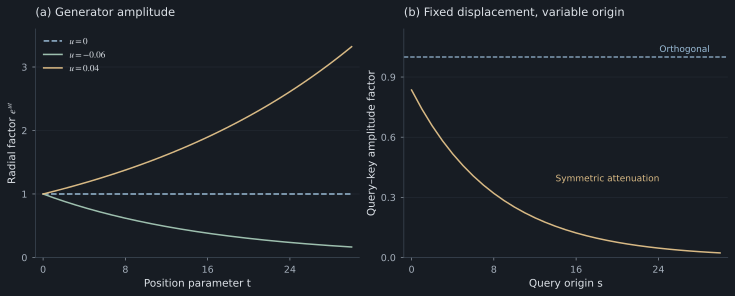

# 5. Matrix generators and norm stability

The supplied notes formulate positional transformations as continuous groups of linear maps. This section derives their generators and specifies the assumptions required for relative-position dependence and norm preservation.

## Continuous translation groups and composition

Suppose $A(t)$ is an **invertible** real linear transformation, with

$$
A(0)=I,\qquad A(s+t)=A(s)A(t).
$$

Assume a continuous real position parameter; for the elementary derivation below, assume differentiability. Setting $s=-t$ gives $A(-t)=A(t)^{-1}$. Invertibility and the identity condition matter: the zero matrix family also satisfies the composition equation, but is not a group.

Let $X=A'(0)$. Differentiating the composition law gives

$$
A'(t)=A(t)X,\qquad A(0)=I.
$$

The solution is

$$
A(t)=e^{tX}=\sum_{n=0}^{\infty}\frac{t^nX^n}{n!}.
$$

The generator $X$ tells us the instantaneous direction of change. For a scalar system $x'=ux$, the solution is exponential growth or shrinkage. For matrices, the direction of change can include turning.

This describes a family under specific linearity and translation-consistency assumptions. It is not a classification of all possible neural position mechanisms.

## Skew-symmetric generator of a planar rotation

Let

$$
J=\begin{pmatrix}0&-1\\1&0\end{pmatrix},\qquad J^2=-I.
$$

Separating the even and odd terms in the exponential series gives

$$
e^{t\theta J}=I\cos(t\theta)+J\sin(t\theta)=R(t\theta).
$$

The differential equation $x'=\theta Jx$ always pushes the vector perpendicular to itself, causing rotation. Since perpendicular motion has no radial component, length stays constant.

For a full RoPE head,

$$
X=\operatorname{diag}(\theta_0J,\ldots,\theta_{M-1}J),\qquad R_t=e^{tX}.
$$

## Orthogonality and the relative-position identity

For $A(t)$ to preserve the Euclidean norm for every vector, require $A(t)^\top A(t)=I$. Differentiating at zero yields

$$
X^\top+X=0.
$$

Conversely, a real skew-symmetric generator has orthogonal exponentials. It can be expressed in an orthonormal basis as independent rotation blocks, possibly with constant directions. Thus a bank of rotations is a natural consequence of continuous translation consistency **plus Euclidean norm preservation**.

The group property alone is insufficient for the familiar query–key identity:

$$
A(s)^\top A(t)=A(t-s)
$$

requires $A(s)^\top=A(s)^{-1}$. RoPE has this property because it is orthogonal.

For a general invertible family, one can instead choose separate query and key maps

$$
F(s)=A(-s)^\top,\qquad G(t)=A(t),
$$

so that $F(s)^\top G(t)=A(t-s)$. These dual maps can scale very differently, creating conditioning problems that RoPE avoids.

## Eigenvalue decomposition and amplitude dynamics

If a generator is diagonalizable, $X=PDP^{-1}$ gives $e^{tX}=Pe^{tD}P^{-1}$. A conjugate eigenvalue pair $u\pm i\theta$ corresponds to a real block

$$
e^{ut}R(t\theta).
$$

The real part $u$ controls amplitude; the imaginary part $\theta$ controls turning. Pure RoPE uses $u=0$.

Purely imaginary eigenvalues by themselves do not guarantee Euclidean norm preservation in an arbitrary basis. A nonorthogonal change of basis can distort lengths. Skew symmetry in the actual dot-product coordinates is the stronger condition used here.

*Figure 5. Generator amplitude and translation consistency. Left: radial factor $e^{ut}$ for pure rotation, attenuating rotation, and growing rotation. Right: amplitude factor obtained by applying identical attenuating maps to both query and key at fixed displacement 3. Its dependence on the absolute origin violates pure relative-position dependence.*

For example, putting the same damping on query and key gives

$$
F(s)=e^{-\gamma s}R_s,\quad G(t)=e^{-\gamma t}R_t,
$$

and hence

$$
F(s)^\top G(t)=e^{-\gamma(s+t)}R_{t-s}.
$$

The extra factor depends on $s+t$. Simply shrinking both vectors as their positions increase does not create pure relative recency.

## Nilpotent generators and additive linear biases

A non-diagonalizable generator can produce polynomial terms. If

$$
N=\begin{pmatrix}0&1\\0&0\end{pmatrix},\qquad N^2=0,
$$

then $e^{tN}=I+tN$, a shear. It obeys the group law but does not preserve norms. Using that same shear on queries and keys does not automatically produce RoPE's transpose/inverse identity.

ALiBi uses a different operation: an **additive logit bias**. For causal lag $r=s-t\ge0$,

$$
\ell^{\rm ALiBi}_{st}=\frac{q_s^\top k_t}{\sqrt{d_h}}-\alpha_h r.
$$

Before normalization, this multiplies content affinity by $e^{-\alpha_h r}$. The linear function can be represented with suitable auxiliary coordinates, but that does not identify ALiBi with a naive shear of the original content vectors. The [ALiBi paper](https://arxiv.org/abs/2108.12409) supplies the method and head-dependent slopes.

## Discrete token indices and continuous extensions

Actual token positions are integers. An invertible discrete family has $A(n)=M^n$; a continuous real extension $e^{tX}$ is an additional assumption. Not every real invertible matrix has a real logarithm. For instance, the one-dimensional map $M=-1$ has no real scalar logarithm, though it defines valid integer powers.

RoPE explicitly chooses a continuous rotation family, making both integer token positions and fractional interpolated positions meaningful.

[Section 6: RoPE in autoregressive Transformer layers →](06-llms.md)
