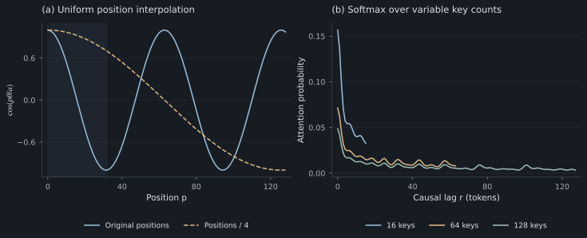
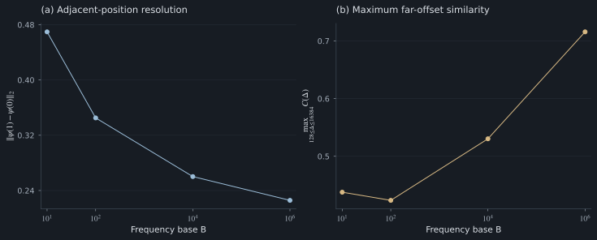

# 7. Context-length generalization and position scaling

RoPE remains mathematically defined beyond the training position range. Reliable prediction at those positions is a separate empirical property.

## Distribution shift, phase recurrence, and attention competition

**Unfamiliar phase combinations.** Training on prefixes of length $L_{\rm train}$ exposes only certain offsets, content patterns, and distractor counts. Longer inputs change those distributions even if all coordinates remain numerically valid.

**Near-recurrence.** Every rotating pair wraps around. A joint near-collision at offsets differing by $D$ requires

$$
D\theta_i\approx2\pi n_i
$$

across many active pairs. This is more restrictive than one pair wrapping, so a single wrap is not a joint collision. Integer offsets and floating-point arithmetic also matter. Finite-frequency phase codes can nevertheless come arbitrarily close again over sufficiently large domains; exact integer-period claims need separate justification.

**Attention competition.** A correct key must compete with more alternatives. Reasoning may require several retrieval steps, and an error at one step can propagate.

*Figure 6. Position rescaling and attention normalization. Left: a single cosine component at frequency 0.1 before and after division of positions by four. Right: the constructed logit $4C(r)$ normalized over 16, 64, or 128 keys. The shaded interval specifies the illustrative training position range; these curves are deterministic calculations rather than trained-model attention.*

The synthetic-task results test the combined effect of longer sequences. They do not identify recurrence as the cause of any particular failure. At the tested lengths, ordinary distribution shift can already be enough.

## Frequency base and positional resolution

For

$$
\theta_i=B^{-2i/d_h},
$$

increasing $B$ slows pairs with $i>0$; the highest frequency $\theta_0=1$ remains unchanged. Slower modes cover larger continuous periods but change less between adjacent positions.

*Figure 7. Geometric diagnostics of base selection, $d_h=64$. Left: distance between adjacent normalized phase codes. Right: maximum signed similarity over integer offsets 128–16384. Points are exact diagnostics for four specified bases; connecting lines indicate their ordering and do not represent fitted models. These quantities do not rank trained language models.*

A larger base is not automatically more unique or better. Low-frequency pairs that barely move may remain similar across much of a chosen domain. A useful spectrum balances resolution at relevant distances with useful training coverage.

The trained lab models use head dimension 16; these explanatory spectrum figures use dimension 64. Neither dimension should be silently substituted for the other when interpreting the curves.

## Uniform position interpolation

To stretch a target context by factor $a>1$, use fractional positions

$$
s'=s/a,\quad t'=t/a,\quad
\Delta'=\Delta/a.
$$

This is equivalent to changing every frequency to $\theta_i/a$. A target window four times as long maps roughly into the original phase range. It also makes a four-token lag resemble the old one-token lag. Local geometry changes.

The [Position Interpolation paper](https://arxiv.org/abs/2306.15595) combines position rescaling with adaptation of pretrained models. In this lab, the separate **RoPE / 4** measurement changes only inference-time phases in a frozen small-decoder checkpoint. It tests that intervention; it does not reproduce the paper's adapted model.

The distinction matters because a network can have learned a particular phase signature for “four tokens back.” Changing that signature without training can destroy a previously solved task.

## Frequency-dependent context extension

Frequency-dependent scaling can preserve some local modes while stretching slower ones. [YaRN](https://arxiv.org/abs/2309.00071) is one researched approach to extending a trained model's context using a more elaborate scaling and adaptation recipe. Such methods are complete procedures, not merely interchangeable values for a single base.

When comparing long-context systems, record the original checkpoint, rotary dimension and layout, frequencies, context lengths, any attention rescaling, adaptation data, and update budget. Also verify cache consistency if the effective schedule changes during generation.

## Evaluation requirements for context extension

A convincing evaluation would include:

- Natural-text loss across positions and document types.
- Retrieval across both context length and needle location.
- Local syntax, arithmetic, and code behavior retained at short lengths.
- Multi-step reasoning requiring several distant facts.
- Latency, memory, and cache correctness at target lengths.

A single successful retrieval example cannot establish all of these. Neither can the small tasks in this repository. They reveal mechanisms and failure cases that a larger evaluation must then test.

[Section 8: Evaluation criteria and experimental protocol →](08-evaluation.md)
