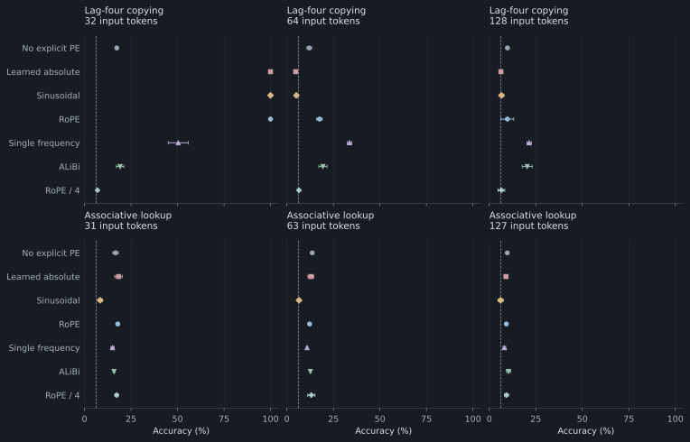
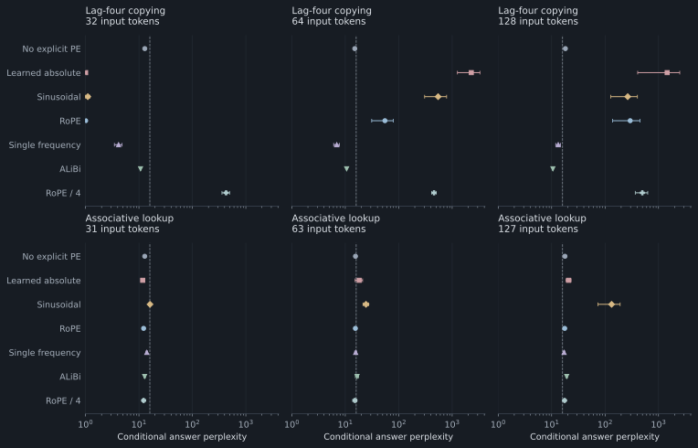
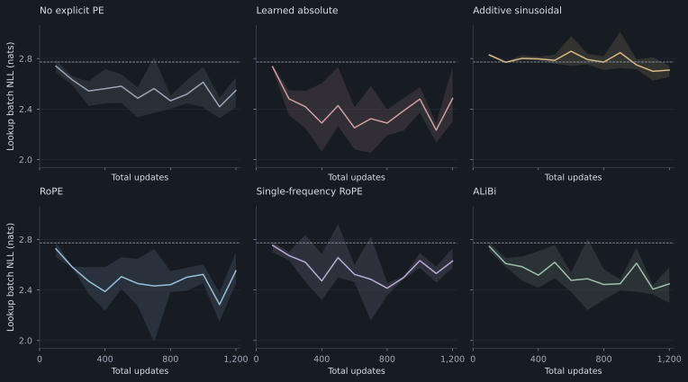

# 9. Empirical results and limitations

## Evaluation protocol and summary statistics

The recorded experiment comprises 18 decoders: six positional methods and three training seeds. Each task/length condition contains 768 held-out answers per seed; the held-out examples are shared across methods and training seeds. Tables report **mean ± sample standard deviation across seeds**. These are descriptive summaries rather than confidence intervals. The [experimental protocol](08-evaluation.md) specifies all controls and limitations.

*Figure 8. Exact answer accuracy for each method at three input lengths. Panels separate tasks and context lengths to avoid overlapping trajectories. Points show means across three training seeds; horizontal bars show ± one sample standard deviation. The vertical dashed line is uniform guessing over 16 valid answer values (6.25%). The first column uses a training input length.*

## Fixed-lag copying: accuracy and conditional perplexity

| Method | 32 tokens: accuracy % | 64 tokens: accuracy % | 128 tokens: accuracy % |
|---|---:|---:|---:|
| No explicit PE | 17.32 ± 0.60 | 12.02 ± 1.26 | 9.77 ± 0.78 |
| Learned absolute | 100.00 ± 0.00 | 4.69 ± 0.00 | 6.25 ± 0.00 |
| Additive sinusoidal | 100.00 ± 0.00 | 5.08 ± 0.23 | 6.60 ± 1.18 |
| RoPE | 100.00 ± 0.00 | 17.53 ± 1.50 | 9.72 ± 3.45 |
| Single-frequency RoPE | 50.39 ± 5.41 | 33.64 ± 1.18 | 21.44 ± 1.21 |
| ALiBi | 19.14 ± 2.02 | 19.36 ± 2.18 | 20.40 ± 2.67 |
| RoPE / 4 (frozen) | 6.99 ± 0.30 | 6.47 ± 0.53 | 6.51 ± 1.81 |

| Method | 32 tokens: answer PPL | 64 tokens: answer PPL | 128 tokens: answer PPL |
|---|---:|---:|---:|
| No explicit PE | 12.87 ± 0.17 | 15.06 ± 0.54 | 18.10 ± 0.56 |
| Learned absolute | 1.01 ± 0.00 | 2279.50 ± 1024.30 | 1450.87 ± 1043.55 |
| Additive sinusoidal | 1.11 ± 0.11 | 546.11 ± 240.93 | 265.36 ± 137.64 |
| RoPE | 1.01 ± 0.00 | 55.25 ± 24.04 | 295.00 ± 157.13 |
| Single-frequency RoPE | 4.16 ± 0.68 | 6.92 ± 0.85 | 13.29 ± 1.36 |
| ALiBi | 10.72 ± 0.10 | 10.61 ± 0.03 | 10.56 ± 0.20 |
| RoPE / 4 (frozen) | 427.20 ± 69.26 | 458.11 ± 41.28 | 497.75 ± 130.35 |

## Associative lookup: accuracy and conditional perplexity

| Method | 31 tokens: accuracy % | 63 tokens: accuracy % | 127 tokens: accuracy % |
|---|---:|---:|---:|
| No explicit PE | 16.67 ± 1.50 | 13.63 ± 0.53 | 9.68 ± 0.33 |
| Learned absolute | 18.32 ± 2.10 | 12.89 ± 1.66 | 8.94 ± 0.62 |
| Additive sinusoidal | 8.38 ± 1.20 | 6.51 ± 0.90 | 6.08 ± 1.37 |
| RoPE | 17.88 ± 0.66 | 12.20 ± 0.42 | 9.16 ± 0.27 |
| Single-frequency RoPE | 15.06 ± 0.87 | 10.85 ± 0.40 | 8.12 ± 0.76 |
| ALiBi | 15.84 ± 0.46 | 12.63 ± 0.23 | 10.33 ± 1.09 |
| RoPE / 4 (frozen) | 17.27 ± 0.76 | 13.15 ± 1.94 | 9.20 ± 1.09 |

| Method | 31 tokens: answer PPL | 63 tokens: answer PPL | 127 tokens: answer PPL |
|---|---:|---:|---:|
| No explicit PE | 12.84 ± 0.10 | 15.52 ± 0.77 | 17.77 ± 0.91 |
| Learned absolute | 11.76 ± 0.85 | 18.19 ± 2.89 | 20.84 ± 2.24 |
| Additive sinusoidal | 16.12 ± 0.85 | 24.42 ± 2.94 | 132.47 ± 58.73 |
| RoPE | 12.24 ± 0.63 | 15.46 ± 0.87 | 17.57 ± 0.88 |
| Single-frequency RoPE | 14.04 ± 0.48 | 15.64 ± 0.66 | 17.09 ± 0.60 |
| ALiBi | 12.79 ± 0.44 | 16.63 ± 1.17 | 19.12 ± 0.68 |
| RoPE / 4 (frozen) | 12.24 ± 0.83 | 15.15 ± 1.28 | 17.48 ± 1.10 |

## Interpretation of method and context-length effects

**Training-length copying.** Learned positions, additive sinusoids, and multiscale RoPE attain 100% held-out copying accuracy at 32 tokens in these runs. The decoder without explicit positional encoding performs substantially worse under the same training procedure.

**Length extrapolation.** RoPE satisfies the norm, common-shift, gradient, and cache checks but loses copying accuracy at longer lengths. The mathematical invariants therefore do not determine the length-generalization behavior learned under this protocol.

**Frequency ablation.** Multiscale RoPE outperforms the single-frequency variant at the training length, while the single-frequency variant retains higher copying accuracy at the longer tested lengths. The ranking depends on the evaluation domain and finite training procedure.

**Frozen position interpolation.** Dividing positions by four reduces copying accuracy in the frozen RoPE checkpoints. The intervention changes the phase representation of the required four-token lag. No adaptation is performed, so this condition is distinct from published fine-tuned interpolation procedures.

**Associative lookup.** Every method remains substantially below oracle performance, including at the training length. Above-uniform accuracy can reflect value frequencies or other shortcuts and does not establish reliable key–value binding.

## Conditional answer perplexity

*Figure 9. Conditional answer perplexity on the held-out answer token, using full-vocabulary logits. The horizontal axis is logarithmic. Points show means across seeds; bars show ± one sample standard deviation, clipped at the natural lower bound of 1 where necessary. The vertical dashed reference is perplexity 16, corresponding to a predictor uniform over valid answer values. These are not corpus language-model perplexities.*

## Optimization trajectories on associative lookup

*Figure 10. Lookup-minibatch negative log likelihood recorded every 100 total training updates. Lines show the mean across three seeds; shaded regions show their minimum and maximum. Each observation uses a newly sampled batch. These ranges describe the recorded seeds and are not confidence intervals. The dashed reference is log(16).*

## Scope of empirical conclusions

The results demonstrate that explicit position information can support precise local addressing under this training budget. They also demonstrate that the best observed method changes with the evaluation length. None of the tested methods provides uniformly reliable behavior across all conditions.

The unresolved lookup task, absence of method-specific tuning, small model size, and synthetic data restrict the conclusions. Selection for a production LLM requires natural-text evaluation and larger-scale controlled comparisons.

The geometric base sweep in [section 7](07-long-context.md) measures phase properties. It does not determine the best base for these trained models, whose conventional RoPE base is fixed.

## Recorded measurements and provenance

- [Per-seed CSV measurements](https://github.com/camianunez/positional-encoding-in-llms/blob/main/experiments/results/metrics.csv)
- [Aggregated JSON statistics](https://github.com/camianunez/positional-encoding-in-llms/blob/main/experiments/results/summary.json)
- [Environment and protocol](https://github.com/camianunez/positional-encoding-in-llms/blob/main/experiments/results/environment.json)
- [Individual training-run records](https://github.com/camianunez/positional-encoding-in-llms/tree/main/experiments/results)

The report verifies method and seed identities, source hashes, metric counts, held-out example counts, and the NLL/perplexity relation before generating the tables. All figures use the shared rendering specification and the recorded measurements.

[Section 10: Reference implementation and numerical verification →](10-implementation.md)
